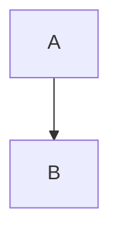
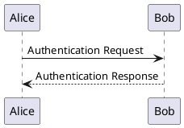

# Formatting

## Customizing the page layout

If you set the Layout to plain, the page layout can be customized using HTML comments inside the markdown:

```markdown
<!-- Layout: plain -->
<!-- ac:layout -->

<!-- ac:layout-section type:three_with_sidebars -->
<!-- ac:layout-cell -->
More Content
<!-- ac:layout-cell end -->
<!-- ac:layout-cell -->
More Content
<!-- ac:layout-cell end -->
<!-- ac:layout-cell -->
Even More Content
<!-- ac:layout-cell end -->
<!-- ac:layout-section end -->

<!-- ac:layout-section type:single -->
<!-- ac:layout-cell -->
Still More Content
<!-- ac:layout-cell end -->
<!-- ac:layout-section end -->

<!-- ac:layout end -->
```

Please be aware that mark does not validate the layout, so it's your responsibility to create a valid layout.

### Placeholders

You can use this to define placeholders:

```markdown
<!-- ac:placeholder -->
Placeholder
<!-- ac:placeholder end -->
```

## Code Blocks

````text
```bash
...
some long bash code block
...
```
````

| Parameter                      | Default |
| ------------------------------ | ------- |
| `collapse`                     | false   |
| `title`                        | none    |
| `linenumbers`                  | false   |
| `1` (any number for firstline) | 1       |

Example:

* `bash collapse`
  If you have long code blocks, you can make them collapsible.
* `bash collapse title Some long long bash function`
  And you can also add a title.
* `bash linenumbers collapse title Some long long bash function`
  And linenumbers.
* `bash 1 collapse title Some long long bash function`
  Or directly give a number as firstline number.
* `bash 1 collapse midnight title Some long long bash function`
  And even themes.
* `- 1 collapse midnight title Some long long code`
  Please note that, if you want to have a code block without a language
  use `-` as the first character, if you want to have the other goodies.

More details at Confluence [Code Block Macro](https://confluence.atlassian.com/doc/code-block-macro-139390.html) doc.

## Block Quotes

### GitHub Alerts Support

You can now use GitHub-style alert syntax in your markdown, and Mark will automatically convert them to Confluence macros:

```markdown
> [!NOTE]
> This creates a blue info box - perfect for helpful information!

> [!TIP]
> This creates a green tip box - great for best practices and suggestions!

> [!IMPORTANT]
> This creates a blue info box - ideal for critical information!

> [!WARNING]
> This creates a yellow warning box - use for important warnings!

> [!CAUTION]
> This creates a red warning box - perfect for dangerous situations!
```

### Technical Details

Block Quotes are converted to Confluence Info/Warn/Note box when the following conditions are met:

1. The BlockQuote is on the root level of the document (not nested)
2. The first line of the BlockQuote contains one of the following patterns `Info/Warn/Note` or [GitHub MD Alerts style](https://docs.github.com/en/get-started/writing-on-github/getting-started-with-writing-and-formatting-on-github/basic-writing-and-formatting-syntax#alerts) `[!NOTE]/[!TIP]/[!IMPORTANT]/[!WARNING]/[!CAUTION]`

| GitHub Alerts | Confluence | Description |
| --------------- | ------------ | ------------- |
| `[!TIP]` (green lightbulb) | Tip (green checkmark in circle) | Helpful suggestions and best practices |
| `[!NOTE]` (blue I in circle) | Info (blue I in circle) | General information and notes |
| `[!IMPORTANT]` (purple exclamation mark in speech bubble) | Info (blue I in circle) | Critical information that needs attention |
| `[!WARNING]` (yellow exclamation mark in triangle) | Note (yellow exclamation mark in triangle) | Important warnings and cautions |
| `[!CAUTION]` (red exclamation mark in hexagon) | Warning (red exclamation mark in hexagon) | Dangerous situations requiring immediate attention |

In any other case the default behaviour will be resumed and html `<blockquote>` tag will be used

## Definition Lists

A definition list is published as a two-column table, with each term heading its
own row:

```markdown
Term
: What it means

Another term
: One definition
: And a second
```

Confluence storage format has no `<dl>`, `<dt>` or `<dd>` — its sanitiser drops
all three, which left the list as an unstructured run of text with the terms no
longer distinguishable from what defined them. A table is what the Confluence
editor produces for this shape, and it is what the elements mean.

Several definitions of one term share its cell rather than each taking a row,
since a row with no term to head it reads as though something is missing.

## Table column widths

Confluence sizes table columns itself unless it is told otherwise. To set the
widths, put a `Column-Widths` comment directly before the table, with one width
in pixels per column:

```markdown
<!-- Column-Widths: 160,720 -->

| Name | Description |
|------|-------------|
| id   | The identifier |
```

The table is published with a `<colgroup>` that sets each column's width, and
the comment itself does not appear on the page. GitHub and GitLab show the
comment as nothing at all, so the table stays an ordinary table there.

* The comment applies to the next table only, and must be the block just before
  it; blank lines between the two are fine. A comment with anything else
  between it and a table is left alone, with a warning.
* Widths are plain positive whole numbers, in pixels. Percentages, `auto` and
  units such as `px` are not accepted.
* The number of widths must equal the number of columns. If it does not, or a
  value is not valid, mark warns and publishes the table without widths.
* A table without the comment is published exactly as before.

## Task Lists

Mark supports [GitHub Flavored Markdown task lists](https://github.github.com/gfm/#task-list-items-extension-).
Task lists are automatically converted to Confluence `ac:task-list` elements.

```markdown
- [x] Finished task
- [ ] Unfinished task
```

A list holding both kinds is published as one Confluence task list per run of
checkboxes and one ordinary list per run of bullets, in the order they were
written — mixing `<ac:task>` and `<li>` inside a single container is not
something the storage format allows.

An *ordered* mixed list is the exception: splitting it would restart the
numbering at every run, so it falls back to a standard list with textual `[x]`
and `[ ]` markers, which keeps the completion state visible if not actionable.

## Date Badges

Interactive Confluence date badges (`<time datetime="YYYY-MM-DD" />`) can be generated by enabling the `--features date` flag. Both HTML `<time>` tags and `@date(YYYY-MM-DD)` macro directives are converted:

```markdown
Release on @date(2026-07-27) or <time datetime="2026-12-31">December 31, 2026</time>.
```

## Render Mermaid Diagram

Confluence doesn't provide [mermaid.js](https://github.com/mermaid-js/mermaid) support natively. Mark provides a convenient way to enable the feature like [GitHub does](https://github.blog/2022-02-14-include-diagrams-markdown-files-mermaid/).
As long as you have a code block marked as "mermaid", mark will automatically render it as a PNG image and attach it to the page as a rendered version of the code block.



A diagram is published as a PNG by default, scaled by `--mermaid-scale`.
`--mermaid-output=svg` publishes the drawing itself instead: one file that is
sharp at any zoom and whose text stays text, on an instance that displays an SVG
attachment. `--mermaid-scale` applies to either -- it multiplies the pixels of a
PNG, and the size the page displays an SVG at. It has to be a finite number
greater than 0, and a PNG that would come out wider or taller than 16384 pixels,
or larger than 64 million pixels in all, is refused rather than captured: make
the diagram smaller or lower the scale.

`--mermaid-bundle` keeps the diagram's own source inside that SVG, in its
`<desc>` element, so what was published can be opened and edited again from the
attachment without the document it came from. It needs `--mermaid-output=svg`:
a PNG has nowhere to keep it.

### Drawing without a browser

Diagrams are drawn by a headless browser running mermaid.js, which is what
mermaid.js is built for and what mark has always done.

`--mermaid-engine=merman` draws them with [merman](https://github.com/Latias94/merman)
instead, a native implementation that needs no browser -- useful where starting
Chrome is awkward or slow, such as a minimal CI image. It is installed
separately, and mark reports it by name if it is missing.

**Experimental.** merman is a reimplementation rather than mermaid.js, so a
diagram may come out differently, or not at all, and which diagrams those are is
not written down anywhere. mark says so once per run when it is selected. The
default is unchanged.

A minimum merman version is required, and an older binary is refused by name
rather than left to draw something else: merman changed how its operations work
across a release, and a version from before that answers for itself perfectly
well and then draws differently. The version is in `mermaid/merman-version.txt`,
which mark embeds and which the Dockerfile and CI both read, so it is written
down once.

The published Docker image carries merman on `amd64`, which is where it
publishes a Linux build; an `arm64` image draws with Chrome.

## Render D2 Diagram

Optionally you can enable [D2](https://github.com/terrastruct/d2) rendering via `--features="d2"`.
This will transform the d2 diagram into a png that will be attached to Confluence, similar to how mermaid-go support works.
All you need is a codeblock marked as "d2".

```d2
X -> Y
```

`--d2-output=svg` attaches the drawing itself instead: one file that is sharp at
any zoom and whose text stays text, on an instance that displays an SVG
attachment. `--d2-scale` applies to either -- it multiplies the pixels of a PNG,
and the size the page displays an SVG at.

An image the diagram references is inlined into the SVG, the way d2's own
`--bundle` does it, because Confluence serves the attachment from its own host
where a path relative to the document resolves to nothing. A reference that
cannot be read fails the run rather than publishing a diagram with a hole in it.

A `|md |` label is passed into the drawing as markup, and mark both renders that
drawing through a browser and uploads it for other people to open. A diagram
that would run something rather than depict something -- a `<script>`, an
`<iframe>`, an event handler, a `javascript:` link -- is refused rather than
published. Everything a label is written for, from bold text to links and
images, is unaffected.

Because the file carries what it points at, what it may point at is limited:

* A **file** must be inside the diagram's own directory or the one mark is
  running in, the same boundary an attachment is held to. One elsewhere is
  refused, so a diagram naming `/etc/id_rsa` cannot publish it.
* A **URL** is not fetched unless `--d2-bundle-remote` says so. The request is
  made by the document rather than by you, to any address it names -- a loopback
  or cloud metadata one included -- and the answer is published inside the
  drawing. Set it for documents whose diagrams you trust. Without it, a diagram
  whose icon or `shape: image` names an `http` or `https` URL is refused, and the
  file fails with an error that names the URL and the flag, since Confluence
  would not resolve the URL from inside the SVG either. The flag changes nothing
  for a PNG.

## Render PlantUML Diagrams

Optionally you can enable [PlantUML](https://plantuml.com/) diagram rendering via `--features="plantuml"`.
Unlike Mermaid and D2 which are rendered locally, code blocks marked as "plantuml" are rendered in Confluence by the [PlantUML for Confluence Macro](https://avono-support.atlassian.net/wiki/spaces/PUML/pages/9699367/Macro+plantuml).
This requires the PlantUML for Confluence macro to be installed in your Confluence instance.



## MkDocs' Admonitions

Optionally you can enable mkdocs-style [Admonitions](https://squidfunk.github.io/mkdocs-material/reference/admonitions/) via `--features="mkdocsadmonitions"`.

When enabled, this renders note, warning, tip, info admonitions as Confluence alerts.

```markdown
!!! note
```

## HTML Details/Summary Macro

Standard HTML `<details>` and `<summary>` tags are converted to native
Confluence `expand` macros:

```markdown
<details>
<summary>Click to expand</summary>
This is the hidden content.
</details>
```

## LaTeX & Math Formulas

Optionally you can enable LaTeX / Math formula rendering via `--features="math"`.

Each formula is rendered as an image, uploaded as a page attachment, and shown
with `<ac:image>` — the same thing mark already does with mermaid and d2
diagrams. The LaTeX stays with it as the image's alt text, so the formula is
still findable by search and readable to a screen reader.

**Inline math**, with either pair of delimiters:

```markdown
Euler's identity is $e^{i\pi} + 1 = 0$, or \(e^{i\pi} + 1 = 0\).
```

**Display math**, likewise:

```markdown
$$
\int_0^\infty e^{-x^2} dx = \frac{\sqrt{\pi}}{2}
$$

\[
f(x) = \int_{-\infty}^\infty \hat{f}(\xi)\,e^{2\pi i \xi x}\,d\xi
\]
```

A `$$` alone on a line opens a formula that runs to the next `$$` alone on a
line, so a formula may contain blank lines — which is how `aligned` and
`gather` environments are written:

```markdown
$$
\begin{aligned}
  a &= b + c \\

  d &= e + f
\end{aligned}
$$
```

The `\[` and `\]` markers work the same way, and a run of more than two
dollars is matched by its own length, so `$$$` opens and closes a formula too.

Written that way the formula is a block of its own, so it may sit inside a
blockquote or a list item without the `>` or the indentation reaching LaTeX. A
formula that opens and closes on one line — `$$E = mc^2$$` — is read as it
always was, wherever it is written.

`\[` is CommonMark's escape for a literal bracket, so the bracket form is only
read as a formula when the formula is the whole of the line it is on: `use
\[brackets\] here` is a sentence about brackets.

A dollar sign in ordinary prose is left alone: a formula may not begin or end
with a space, so `it costs $5 and $7 today` is a sentence about money rather
than mathematics. `\$5` is always literal, and anything inside a code span or a
code block is quoted rather than rendered — including a `$$` fence, so a
document explaining this syntax publishes the example rather than a picture of
it.

A formula MathJax cannot read fails the file, quoting both the formula and the
complaint — `unable to render formula "\frac{a": Missing close brace` — rather
than publishing a picture of the error message.

Typesetting is done by [mathjax-go](https://github.com/d2lang/mathjax-go), with
no CGO and no Confluence plugin on the instance. The same formula written twice
on a page is uploaded once.

### Choosing the image format

| `--math-format` | What you get | What it costs |
| --- | --- | --- |
| `png` (default) | What Confluence certainly displays, and what the diagram renderers have always produced | Rasterised through the same headless Chrome mermaid uses |
| `svg` | Vector: sharp at any zoom, a few kilobytes | Nothing — no browser at all — where the instance displays an SVG attachment |

```bash
mark publish --features=math --math-format=svg -f document.md
```

`--math-scale` (2 by default) applies to PNG only, and multiplies the pixels
rather than the size: the image still occupies the space the formula asked for,
with more pixels in it for a display that can use them, because a formula
rasterised 1:1 looks ragged beside the text it sits in. It has to be a finite
number greater than 0.

### Why an image

Confluence has no math of its own, and the usual answer for a Markdown tool —
publishing KaTeX or MathJax HTML — does not survive the trip. That markup is a
pile of positioned `<span>`s whose layout lives entirely in `katex.css`, which a
Confluence page never loads, and it ships a MathML twin and the LaTeX source
alongside. Stripped of the styling Confluence discards, a reader saw the formula
spelled out three times:

```text
Inline math: E=mc2E = mc^2E=mc2 and a Greek pair α+β\alpha + \betaα+β.
```

An SVG carries its own geometry and its glyphs as outlines, so it needs no
stylesheet, no fonts, and nothing installed on the instance.

## Inline Link Cards

Optionally you can render bare URLs as Confluence Cloud **inline smart cards** via `--features="inline-link-card"`.

When enabled, auto-detected URLs in markdown (e.g. `<https://example.com>` or
a bare URL on its own line) are rendered with the `data-card-appearance="inline"`
attribute, which Confluence Cloud uses as a hint to display the link as an
inline card preview (page title, Jira issue summary, GitHub repo card, etc.)
instead of a plain blue hyperlink.

```text
See <https://your-instance.atlassian.net/wiki/spaces/DOCS/pages/12345/Page+Title>
for context.
```

Only **auto-detected URLs** (bare URLs / `<...>` autolinks) are affected.
Markdown-explicit links (`[label](https://...)`) keep their author-chosen
display text and render as regular hyperlinks, unchanged.

*Note: Inline Smart Cards (`data-card-appearance="inline"`) are a **Confluence Cloud** feature. On Confluence Data Center / Server, the attribute is safely ignored and the link displays as a standard hyperlink.*

## Footnotes

Markdown footnotes are rendered as footnotes Confluence can actually navigate.

```markdown
The estimate is optimistic[^basis], and the deadline is not[^deadline].

[^basis]: Measured on the staging cluster, which has half the nodes.
[^deadline]: Set before the scope changed.
```

Each marker becomes a superscript `[1]` linking down to the note, and each note
ends with a `↩` linking back to the sentence that cited it. Notes are collected
into a numbered list under a horizontal rule at the foot of the page, in the
order they were first cited -- so the definitions can be written in whatever
order suits the source file, and a definition nothing cites is left out rather
than numbered.

Citing the same note twice gives it one entry with a numbered arrow per
citation, so both ways back are distinguishable.

### Why it is not a plain HTML footnote

Markdown footnote syntax has always been parsed. What did not work is the
navigation. Goldmark, like every other Markdown renderer, wires the two ends
together with `id` attributes and `href="#id"` links, and Confluence keeps
neither: it discards the ids in the storage format and generates its own from
element text. The result renders, looks right, and does nothing when clicked.
There is nothing to choose between, which is why this is not a feature you turn
on.

The plumbing is replaced with the two things Confluence does understand:

* the **Anchor macro** for the jump targets, which is bundled with both Cloud
  and Data Center and so needs no marketplace plugin, and
* `<ac:link ac:anchor="...">` for the jumps, with no `ri:page` -- an anchor link
  within the current page, which scrolls rather than reloads.

```html
<!-- at the marker -->
<ac:structured-macro ac:name="anchor"><ac:parameter ac:name="">footnote-ref-1</ac:parameter></ac:structured-macro>
<ac:link ac:anchor="footnote-1"><ac:link-body><sup>[1]</sup></ac:link-body></ac:link>

<!-- at the note -->
<li><ac:structured-macro ac:name="anchor"><ac:parameter ac:name="">footnote-1</ac:parameter></ac:structured-macro>
<p>Measured on the staging cluster, which has half the nodes.&#160;<ac:link ac:anchor="footnote-ref-1"><ac:link-body>&#x21a9;&#xfe0e;</ac:link-body></ac:link></p>
</li>
```

Anchor names are `footnote-<n>` and `footnote-ref-<n>`, which share a namespace
with the page's heading anchors -- avoid headings that would generate the same
names.

## Emoji

Optionally you can write emoji as `:shortcode:`, via `--features="emoji"`.

```markdown
Shipped it :tada: and the build is green :white_check_mark:
```

The shortcodes are the GitHub ones. A shortcode no emoji answers to, one inside
a code span or code block, and a bare colon in running text (`10:30`) are all
left exactly as written.

### What ends up in the page

Confluence holds an emoji in `<ac:emoticon>`, and its two flavours read that tag
differently. Data Center goes by `ac:name` and knows only the couple of dozen
names listed in the [storage format
reference](https://confluence.atlassian.com/doc/confluence-storage-format-790796544.html);
Cloud writes `ac:emoji-id`, `ac:emoji-shortname` and `ac:emoji-fallback`
alongside it and takes the glyph from those. A name Data Center does not know
renders as nothing at all.

So `mark` writes whichever of the two is safe on both:

* an emoji Confluence has a legacy name for -- `:smile:`, `:wink:`,
  `:thumbsup:`, `:warning:`, `:white_check_mark:`, `:x:`, `:heart:` and the rest
  of that short list -- becomes the macro, with the name for Data Center and the
  `ac:emoji-*` attributes for Cloud;
* every other emoji is written as the character itself, which both flavours
  render as text without having to understand a macro.

```html
<!-- :white_check_mark: -->
<ac:emoticon ac:name="tick" ac:emoji-shortname=":white_check_mark:" ac:emoji-id="2705" ac:emoji-fallback="✅"/>

<!-- :tada: -->
🎉
```

Several emoji can share one legacy name -- Data Center has one smiley where
Unicode has four -- which is only visible on Data Center, since Cloud picks the
exact emoji from `ac:emoji-id`.

An emoji in a heading is part of that heading's anchor, and the anchor is built
from the source text rather than the rendered emoji: `## Release :tada:` gets
the id `Release-tada`.

This feature is about emoji in the body of a document. The page's icon is set
separately, with the [`<!-- Emoji: -->` header](metadata.md#further-headers), which takes the
character rather than a shortcode.
